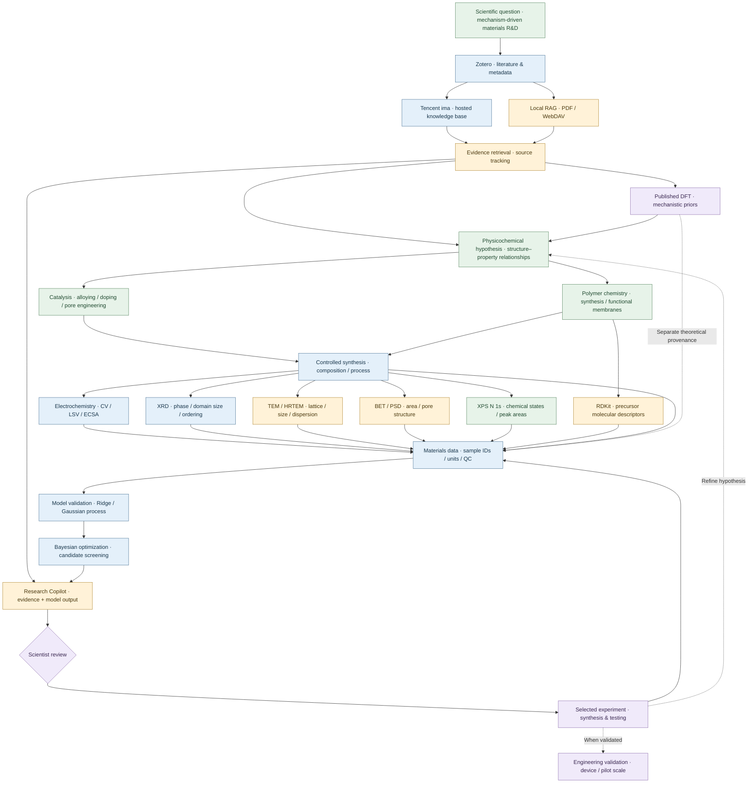

# Y. Peng

**Mechanism-driven Materials R&D | AI for Materials & Science (AI4M/S) | Scientific Computing & Automation**

Materials Science · Electrocatalysis · Electrochemistry · Functional Membranes  
Materials Informatics · Scientific Software · DoE · Bayesian Optimization · Research Agents

I am an industrial materials R&D engineer with hands-on experience in **electrocatalysts, functional membranes, materials characterization, electrochemical evaluation, experimental design, and process scale-up**.

My current focus is **AI for Materials (AI4M) and AI for Science (AI4S)**: connecting domain expertise, experimental data, scientific computing, and AI-assisted workflows to accelerate materials discovery and development.

This portfolio brings together scientific software, data-driven experimental optimization, research agents, and practical engineering tools. Many projects originate from real materials R&D problems. I am building toward reproducible, evidence-grounded, closed-loop research workflows that connect computational recommendations with experimental validation.

---

## 🔁 AI4M/S Research Workflow

**Materials Research Copilot — from scientific evidence to the next experiment.**

A mechanism-driven research architecture connecting **catalysis and polymer / functional membrane chemistry** with literature-informed hypotheses, controlled synthesis, experimental characterization, physics-informed materials informatics and human-reviewed experimental planning. Electrocatalysis is the initial computational case study.

**Legend:** blue = existing tools / workflows; green = established experimental R&D experience (not necessarily automated software); amber = software prototype; purple = planned integration / validation. Published DFT is a literature-derived theoretical prior; independent DFT is optional future work and is not claimed as completed. XPS core-level binding energies are distinct from Pt–support binding energies.

| Module | Implementation |
| --- | --- |
| Scientific knowledge | [Zotero Scholar Bridge](https://github.com/ANDYPENG09/zotero-scholar-bridge) · [Zotero ima Sync](https://github.com/ANDYPENG09/zotero-ima-sync) |
| Mechanistic research | Literature-informed physicochemical hypotheses; catalysis, polymer chemistry and functional membranes; theory-to-experiment validation |
| Materials RAG | Hosted ima retrieval / local PDF and WebDAV retrieval — [prototype, PR #2](https://github.com/ANDYPENG09/bayesian-optimization-electrocatalyst/pull/2) |
| Characterization | [Electrochemistry Analyzer](https://github.com/ANDYPENG09/PEMFC-Electrocatalyst-Activity-Analyzer) · [XRD Toolkit](https://github.com/ANDYPENG09/xrd-toolkit) |
| XPS surface chemistry | Experimental N 1s peak deconvolution experience; [chemical-state descriptor template](https://github.com/ANDYPENG09/ai4ms-porous-carbon-engineering/blob/main/data/templates/xps_n1s_components.csv); automated fitting and verified sample linkage not implemented |
| Literature-derived first-principles knowledge | [Carbon research roadmap](https://github.com/ANDYPENG09/ai4ms-porous-carbon-engineering/blob/main/docs/first-principles.md) · model-specific binding energies, charge transfer and electronic structure as traceable priors; no independent DFT results claimed |
| TEM / HRTEM | [TNLA v0.1](https://github.com/ANDYPENG09/bayesian-optimization-electrocatalyst/tree/main/research_tools/tem) · lattice spacing, particle sizing, geometric dispersion |
| BET / porosimetry | [Porous Carbon Engineering](https://github.com/ANDYPENG09/ai4ms-porous-carbon-engineering) · BET and PSD prototypes, provenance checks, matched-step anomaly diagnostics and optional molecular descriptors |
| Materials informatics | Structured experiment data, sample-ID joins, measurement units and QC; unified database planned |
| AI-driven optimization | [Bayesian Optimization](https://github.com/ANDYPENG09/bayesian-optimization-electrocatalyst) · Ridge / Gaussian process validation · uncertainty-aware experiment planning |
| Research Copilot | Evidence and model-report integration prototype; automated orchestration and prospective validation planned |

**Status:** existing scientific tools, retrospective IrOx model validation, and a synthetic RAG + BO integration demonstration using a cloud-hosted research environment and Python tools via MCP. The porous carbon repository includes BET/PSD analysis, data-quality and molecular-descriptor prototypes, an XPS chemical-state metadata template, and a literature-informed first-principles roadmap with a support–catalyst–electrode data model. Verified experimental linkage, predictive modeling and prospective closed-loop validation remain development goals.

→ [Architecture, methods and IrOx case study](https://github.com/ANDYPENG09/bayesian-optimization-electrocatalyst)

---

## 🧭 Applications & Quality Tools

### Membrane & Gas Separation Support

A bilingual, offline workbench for mixed-gas membrane tests: humid and sweep-gas conditions, GC composition, apparent permeance, separation factors, and structured technical-support reports. Demonstration records are synthetic.

→ [Open the workbench](https://andypeng09.github.io/PEMFC-Electrocatalyst-Activity-Analyzer/membrane-gas-support/) · [Source and methods](https://github.com/ANDYPENG09/membrane-gas-separation-support)

### Technical Support & Quality Workbench

An offline, bilingual prototype for reviewing catalyst test results, checking test conditions and user-defined specifications, documenting troubleshooting hypotheses, and preparing a traceable report. The demonstration uses synthetic scenarios and an anonymized electrochemistry example.

→ [Open the workbench](https://andypeng09.github.io/PEMFC-Electrocatalyst-Activity-Analyzer/technical-support/) · [Source and documentation](https://github.com/ANDYPENG09/PEMFC-Electrocatalyst-Activity-Analyzer/tree/main/technical-support)

---

## 🔬 Featured AI4M/S & Scientific Computing Projects

### 01 · Bayesian Optimization for Electrocatalyst R&D

**Closed-loop experimental optimization for catalyst development**

A Gaussian-process-based workflow for recommending the next experiment from existing catalyst datasets.

**Methods**
- Gaussian Process surrogate modeling
- Matérn 5/2 + ARD kernel
- EI / PI / UCB acquisition functions
- Constraints on stability, cost, particle size, etc.
- Batch experiment recommendation
- Multi-objective optimization
- Uncertainty reporting and experiment traceability

**Example applications**
- PtCo L1₀ ordering optimization
- IrOx OER catalyst optimization
- synthesis–structure–activity exploration

→ [bayesian-optimization-electrocatalyst](https://github.com/ANDYPENG09/bayesian-optimization-electrocatalyst) · [RAG + MCP + BO demonstration](https://github.com/ANDYPENG09/bayesian-optimization-electrocatalyst/blob/main/docs/demo/PORTFOLIO.md)

---

### 02 · Porous Carbon Engineering (AI4M/S)

**Mechanism-driven carbon surface chemistry, pore engineering and physics-informed materials informatics**

The standalone repository includes Python BET and PSD workflows, measurement identity gates, matched-step anomaly diagnostics, activity unit checks, and optional RDKit precursor descriptors. Public examples are synthetic.

| Workstream | Scope |
| --- | --- |
| CO₂ etching and pore development | BET and standardized PSD analysis prototypes; verified process–structure linkage pending. |
| Nitrogen surface chemistry | RDKit precursor descriptors, XPS N 1s chemical-state metadata and experimental characterization; verified data linkage pending. |
| Literature-informed first-principles knowledge | Published DFT as a model-specific mechanistic prior; independent calculations optional; no computed Pt–support binding energy results claimed. |
| Scientific data quality | Mapping confidence, provenance gates and scaling diagnostics; candidate mappings are excluded from supervised training. |
| Catalyst particle TEM | Planned particle-size and dispersion measurements linked to the support and catalyst batch. |
| Electrochemical tests | Planned ECSA and ORR measurements linked to catalyst batches and electrode preparation. |

The workstreams preserve measurement provenance, distinguish candidate matches from confirmed identities, and aim to connect processing, pore structure, particles and performance without leaking proprietary data. [Research cases and limitations](https://github.com/ANDYPENG09/ai4ms-porous-carbon-engineering/blob/main/docs/research-cases.md).

→ [Porous Carbon Engineering · code, tests and roadmap](https://github.com/ANDYPENG09/ai4ms-porous-carbon-engineering)

---

### 03 · PEMFC Electrocatalyst Activity Analyzer

**Offline electrochemical analysis for PEMFC catalyst evaluation**

A browser-based tool for calculating:

- ECSA from H-upd
- ORR mass activity
- ORR specific activity
- N₂ background correction
- kinetic current using the Koutecký–Levich equation

Also includes utilities for processing **Autolab `.paax`** and **Origin `.opju`** data.

The goal is to make routine catalyst evaluation more reproducible and reduce repetitive manual processing.

→ [PEMFC-Electrocatalyst-Activity-Analyzer](https://github.com/ANDYPENG09/PEMFC-Electrocatalyst-Activity-Analyzer)

---

### 04 · PtCo L1₀ XRD Ordering Analysis

**XRD analysis for PtCo intermetallic ordering**

Offline tool for estimating PtCo L1₀ chemical ordering from characteristic XRD reflections.

Methods include:

- SNIP background subtraction
- Gaussian peak fitting
- Levenberg–Marquardt optimization
- overlapping peak deconvolution
- characteristic superlattice/fundamental peak analysis

Developed from practical PtCo catalyst characterization work and currently focused on PtCo/Pt-based catalyst systems.

→ [XRD-PtCoOrdering](https://github.com/ANDYPENG09/XRD-PtCoOrdering)

---

### 05 · XRD Crystallite Size Analysis

Tools for estimating catalyst crystallite size using:

- Scherrer analysis
- Williamson–Hall analysis
- integral-breadth approaches
- Pt / PtCo-specific diffraction workflows

→ [XRD-Scherrer](https://github.com/ANDYPENG09/XRD-Scherrer)

---

## 🧪 Catalyst Research Tools

| Project | Purpose |
|---|---|
| **XRD File Converter** | Convert diffraction files from Rigaku, Bruker, Jade/MDI and generic text formats |
| **Catalyst Search Skill** | Structured literature search for catalysis and electrocatalysis |
| **Catalyst Design Skill** | Literature-grounded catalyst design workflow for HER / OER / ORR / PEMWE |
| **XRD Toolkit** | Collection and integration point for diffraction-analysis tools |

---

## 🎯 Research Interests

- AI for Materials & AI for Science (AI4M/S)
- Materials informatics and scientific data workflows
- Scientific software, research agents and reproducible research automation
- Experimental design, active learning and closed-loop materials development
- Porous carbon engineering, gas adsorption and CO₂ activation
- Functional membranes and materials characterization
- Electrocatalyst synthesis and scale-up
- PEM fuel-cell catalysts
- PEM water-electrolysis catalysts
- Pt and Pt-alloy ORR catalysts
- Ir-based OER catalysts
- synthesis–structure–activity relationships
- catalyst benchmarking and measurement uncertainty
- Design of Experiments
- Bayesian optimization and active learning
- data-driven experimental planning

---

## 🤖 Research AI & Automation

I also build small tools and integrations to improve scientific and technical workflows.

### AI Skills

- **catalyst-search-skill** — Literature retrieval and structured evidence synthesis for catalysis research.
- **catalyst-design-skill** — Traceable catalyst-design reasoning with literature sources, confidence levels, and validation paths.
- **opencode-responses-bridge-skill** — Local compatibility bridge between Chat Completions and Responses-style APIs.

### Scientific Productivity

- Zotero integrations
- literature/RAG workflows
- Hermes Agent extensions
- research automation utilities

These projects complement my experimental materials background and support the same objective: **reducing repetitive work, making scientific reasoning traceable, and shortening the path from a research question to a testable result.**

---

## 🛠 Selected Engineering Projects

| Project | Description |
|---|---|
| **hermes-cache-hit-rate** | Token-cache analytics for Hermes Agent |
| **hermes-gpt-light-theme** | Lightweight dashboard/interface customization |
| **zotero-ima-sync** | Zotero-to-knowledge-base literature synchronization |
| **hermes-multi-task-concurrency-solution** | Diagnosis and workaround for concurrent-session failures |

---

## About

My foundation is **industrial materials R&D**, and my developing focus is **AI4M/S, scientific computing and research automation**.

I use programming, statistics, and AI-assisted development to solve experimental and engineering problems. I am actively strengthening independent Python development, machine learning, and materials informatics skills.

Current direction:

**scientific question → literature & physical mechanism → hypothesis → materials design & synthesis → characterization → curated data & theoretical priors → model / BO → scientist review → next experiment → engineering validation**

---

*Y. Peng · AI4M/S · Materials R&D · Scientific Computing · Data-Driven Experimentation*
